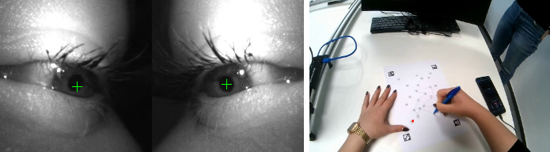
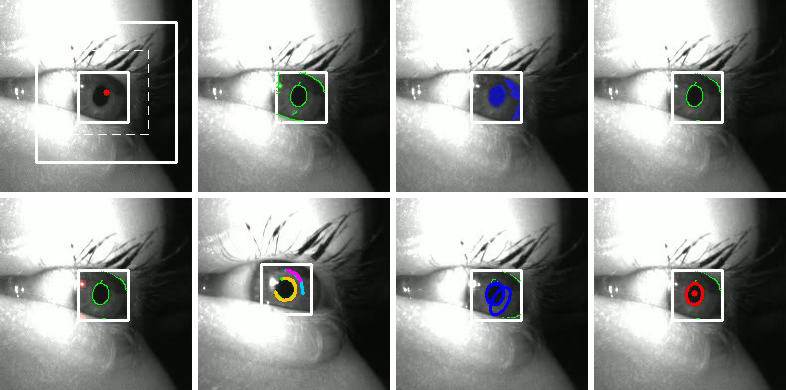
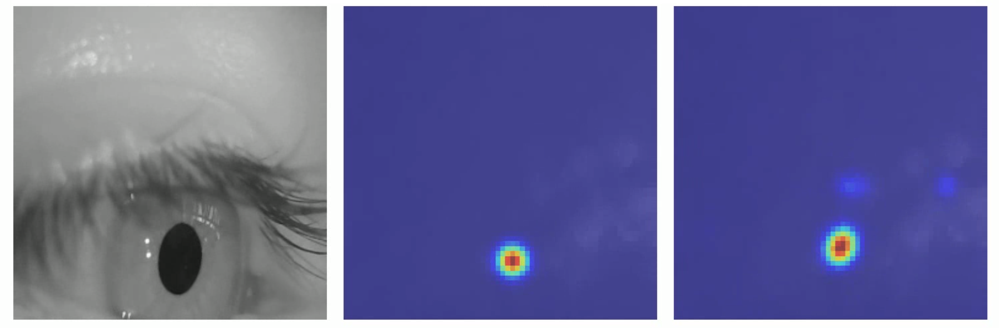

<div align="center">

# 👁️ Pupil Detection & Gaze Mapping

**Robust pupil-center detection in off-axis eye-camera frames and calibration-based gaze mapping onto the scene image**




<sub><i>Pupil center detection in both eye-camera images (left) and the mapped gaze point on the scene camera frame (right).</i></sub>

</div>

---

## 📌 Overview

Accurate gaze estimation depends on precise pupil-center localization. In head-mounted eye trackers this is hard: the camera looks at the eye from a steep **off-axis angle**, the pupil is partially hidden by **eyelids and eyelashes**, and **specular reflections** and **illumination changes** constantly disturb the image.

This project implements a two-stage system:

1. **Pupil detection** — a lightweight neural network proposes a region of interest, and a classical, geometry-based pipeline (edge detection → dark-region filtering → contour segmentation → ellipse fitting) delivers a precise, geometrically consistent pupil center.
2. **Gaze mapping** — binocular pupil features are mapped to 2-D gaze positions in the scene image with Ridge-regularized regression, trained on a small set of calibration fixations.

> 📄 Developed as a lab project (Computer Animation Lab, University of Bonn). The full lab report describes methodology, related work and evaluation in detail.

---

## ✨ Highlights

- 🎯 **Hybrid detector** — NN-based ROI + classical ellipse fitting, combining the robustness of learning with the geometric precision of model-based methods
- 🌗 **Reflection-aware** — specular highlights are detected, dilated and removed from the edge map before fitting
- 🧮 **Edge-support scoring** — the final ellipse is chosen by how well it explains the observed edges, penalized by center distance and aspect ratio
- ⏱️ **200 FPS → 30 FPS alignment** — "best-eye-frame" selection per world frame using `score = min(L_score, R_score)`
- 🧭 **Flexible calibration** — `all_data`, `fixation_medians`, `9_point`, `rectangle_5point`
- 🖱️ **Interactive calibration tool** — click fixation targets directly on the scene video

---

## 🔬 Method

### 1. Pupil detection pipeline

<div align="center">


<sub><i>Intermediate results: ROI selection, edge detection, dark-region filtering, edge filtering, specular reflection removal, contour segmentation, ellipse fitting and final ellipse selection.</i></sub>
</div>

| # | Stage | What happens |
|:-:|-------|--------------|
| 1 | **Preprocessing** | Frame → grayscale |
| 2 | **ROI & initial guess** | ResNet-18 heatmap network predicts a coarse pupil probability map; it is thresholded into a tight bounding region that constrains all later stages |
| 3 | **Edges & dark region** | Gaussian smoothing + Canny; only edges inside a histogram-thresholded dark region are kept |
| 4 | **Reflection removal** | High-intensity spots are detected, dilated and removed from the edge map |
| 5 | **Contour segmentation** | Contours are split at large spatial jumps and sharp curvature changes; short segments are discarded |
| 6 | **Ellipse fitting** | Least-squares ellipse per segment, filtered by minimum area, maximum aspect ratio and distance to ROI center |
| 7 | **Ellipse selection** | Candidates scored by edge support, center distance and aspect-ratio penalty; the best one above a support threshold gives the pupil center |

### 2. Gaze estimation

Gaze mapping is formulated as supervised regression from binocular pupil features

$$\mathbf{f} = (L_{cx},\ L_{cy},\ R_{cx},\ R_{cy})$$

to scene-image coordinates using Ridge regression (L2 regularization):

$$\hat{\mathbf{g}} = W\mathbf{f} + \mathbf{b}$$

A linear model was chosen for stability and reliable extrapolation — higher-order polynomial features are supported, but tended to overfit with limited calibration coverage.

**Evaluation protocol (self-calibration):**

1. Eye frames (~200 FPS) are aligned to world frames (30 FPS); for each world frame the eye frame with the highest `min(L_score, R_score)` is kept.
2. Fixation markers are extracted from `events.csv`.
3. A small set of calibration points (default **`rectangle_5point`**: four corners + center) is chosen, prioritizing high confidence and spatial coverage.
4. The model is trained only on these points and evaluated on **all remaining samples** of the same session.

---

## 📊 Results

### Pupil detection

| Metric | Value |
|--------|------:|
| Detection rate | **35 %** |
| Mean pixel error (before cleaning) | 9.21 px |
| Mean pixel error (after cleaning) | **3.52 px** |

Data cleaning more than halves the localization error; the relatively low detection rate remains the main limiting factor.

### Gaze estimation

| Session | RMSE (px) | Bias (x, y) |
|---------|----------:|------------:|
| `ef3474a6` A | 29.3 | (1.3, 3.4) |
| `ef3474a6` B | 38.5 | (−7.4, −27.4) |
| `f18e4f45` A | 38.4 | (−5.8, −2.6) |
| `f18e4f45` B | 30.1 | (−0.1, 2.8) |
| `32205695` A | **20.1** | (−7.6, 6.6) |
| `32205695` B | 46.2 | (−0.1, −16.9) |
| **Overall mean** | **33.8** | – |
| **Overall median** | **34.3** | – |

Accuracy varies noticeably between sessions: some show low error and almost no bias, others a clear directional drift — the pipeline is sensitive to head pose, illumination and calibration stability.

---

## 🧪 Experiment: pure NN-based pupil detection

As an alternative, a **ResNet-18 heatmap network** was trained to regress the pupil center directly: pre-trained on synthetic **UnityEyes 2**, fine-tuned on **OpenEDS**, evaluated on **LPW** (70/30 split, MSE loss).

<div align="center">


<sub><i>Left to right: input eye image, ground-truth pupil location, predicted heatmap.</i></sub>
</div>

| Metric (LPW) | Value |
|--------------|------:|
| Samples | 10 991 |
| Mean error | 3.40 px |
| Median error | 2.24 px |
| Std. deviation | 3.44 px |
| 90th percentile | 6.71 px |
| 95th percentile | 8.25 px |
| Max error | 44.42 px |

Despite the low mean error, the long error tail and small jitter of the heatmap peak made gaze regression unstable. The network is therefore used **only to place the ROI**, while the final center comes from the classical pipeline.

> 💡 **Key takeaway:** a low average pixel error is not enough for gaze estimation — *consistency* and *geometric stability* of the pupil center matter more.

---

## 🗂️ Repository structure

```
Gaze_estimation/
├── pipeline/
│   ├── pupil_detector.py     # pupil detection (heatmap ROI + classical fitting)
│   ├── downsample.py         # 200 FPS eye data → 30 FPS scene timestamps
│   ├── gaze_mapping.py       # Ridge regression gaze mapping + overlay video
│   ├── calibration_tool.py   # interactive clicking of calibration points
│   ├── convert_to_csv.py     # recording export → CSV
│   └── README.md             # detailed flags & library usage
├── models/
│   └── heatmap_net.py        # ResNet-18 encoder + deconv decoder (HeatmapNet)
├── utils/
│   └── heatmap_infer.py      # heatmap inference helpers
├── eval_lpw/                 # benchmark scripts (LPW, ExCuSe/ElSe, Świrski)
├── results/                  # figures and evaluation summaries
└── docs/images/              # README figures
```

---

## 🚀 Getting started

### Installation

```bash
git clone https://github.com/<your-username>/Gaze_estimation.git
cd Gaze_estimation

python -m venv gaze_env
source gaze_env/bin/activate
pip install opencv-python numpy pandas scikit-learn torch torchvision
# optional, only for the benchmark scripts in eval_lpw/
pip install pupil-detectors
```

> ⚠️ Recordings (`data/`), model checkpoints (`*.pth`), videos and CSV files are **not** included in the repository.

### Expected data layout

```
data/<participant>/
├── Neon Scene Camera v1 ps1.mp4    # scene camera (30 FPS)
├── Neon Sensor Module v1 ps1.mp4   # dual-eye video (~200 FPS, left | right)
├── calibration_points.csv          # created with calibration_tool.py
└── csv/
    ├── timestamps.csv              # eye sensor timestamps (timestamp_ns)
    └── imu.csv                     # IMU quaternions (quat_w/x/y/z)
```

### Run the pipeline

```bash
# 1. Pupil detection
python pipeline/pupil_detector.py \
  --video "data/<participant>/Neon Sensor Module v1 ps1.mp4" \
  --heatmap_ckpt checkpoints_openeds/openeds_finetuned_lpw_validated.pth \
  --out pipeline/outputs/pupils.mp4

# 2. Mark calibration points on the scene video
python pipeline/calibration_tool.py \
  --scene "data/<participant>/Neon Scene Camera v1 ps1.mp4" \
  --eye   "data/<participant>/Neon Sensor Module v1 ps1.mp4" \
  --out   "data/<participant>/calibration_points.csv"

# 3. Align eye data to the 30 FPS scene camera, then 4. map gaze
cd pipeline
python downsample.py   --data_dir ../data/<participant>
python gaze_mapping.py --data_dir ../data/<participant>
```

**Outputs:** `30_fps_data.csv` (aligned pupil coordinates), `gaze_predictions.csv` (per-frame gaze `pred_gaze_x, pred_gaze_y`) and `gaze_overlay.mp4` (scene video with gaze overlay).

<details>
<summary><b>⌨️ Calibration tool controls</b></summary>

| Key | Action |
|-----|--------|
| `Space` | pause / resume |
| `←` / `→` | step one frame (paused) |
| Click | mark calibration point at cursor |
| `1`–`9` | set ID of the next point |
| `u` | undo last point |
| `s` / `Enter` | save CSV and exit |
| `q` / `Esc` | quit without saving |

</details>

See [`pipeline/README.md`](pipeline/README.md) for all detector parameters and how to use the detector as a Python library.

---

## ⚠️ Limitations

- **Sensitivity to pupil detection quality** — illumination changes, eyelid occlusions and reflections still cause errors that propagate directly into calibration data.
- **Limited calibration coverage** — only 5–9 fixation points; large regions of the scene image must be interpolated, making the model prone to local distortion and systematic bias.
- **Session-specific evaluation** — calibration and testing happen within the same session, so cross-session changes in head pose, camera alignment or lighting are not captured.

---

## 📚 References

- Hansen & Ji (2010). *In the Eye of the Beholder: A Survey of Models for Eyes and Gaze.* IEEE TPAMI.
- Fuhl et al. (2015). *ExCuSe: Robust Pupil Detection in Real-World Scenarios.* CAIP.
- Fuhl et al. (2015). *ElSe: Ellipse Selection for Robust Pupil Detection in Real-World Environments.* [arXiv:1511.06575](https://arxiv.org/abs/1511.06575)
- Świrski, Bulling & Dodgson (2012). *Robust real-time pupil tracking in highly off-axis images.* ETRA. [doi](https://doi.org/10.1145/2168556.2168585)
- Kassner, Patera & Bulling (2014). *Pupil: An Open Source Platform for Pervasive Eye Tracking.* [arXiv:1405.0006](https://arxiv.org/abs/1405.0006)
- Tonsen et al. (2016). *Labelled Pupils in the Wild (LPW).* ETRA. [doi](https://doi.org/10.1145/2857491.2857520)
- Garbin et al. (2019). *OpenEDS: Open Eye Dataset.* [arXiv:1905.03702](https://arxiv.org/abs/1905.03702)
- Smith et al. (2025). *UnityEyes 2: Open source robust synthetic eye generation.* ETRA. [doi](https://doi.org/10.1145/3715669.3726838)
- Park et al. (2018). *Learning to find eye region landmarks for remote gaze estimation.* ETRA. [doi](https://doi.org/10.1145/3204493.3204545)
- Zhang et al. (2015). *Appearance-based gaze estimation in the wild.* CVPR. [doi](https://doi.org/10.1109/CVPR.2015.7299081)

---

<div align="center">

**Vadim Chaikin** · University of Bonn · 2026

</div>
